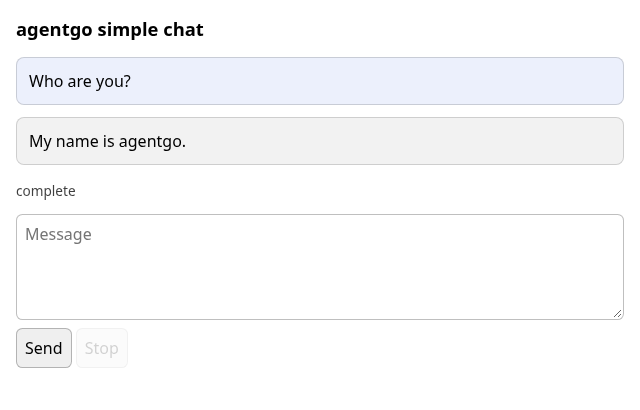
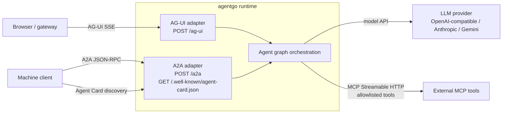

# agentgo

**Turn an `AgentDeployment` artifact into a production-ready agent service — no agent infrastructure to build.**

agentgo is a standalone runtime for agent graphs. You write an
`AgentDeployment` artifact (JSON + prompt files); agentgo runs the agent tree,
orchestrates LLM calls and MCP tools, and serves them over standard protocols.
Your product code never touches Go, agents, or protocol plumbing.





## Why agentgo

Building a production agent system from scratch means implementing, testing,
and maintaining all of this yourself:

| Concern | What you'd build | What agentgo gives you |
|---|---|---|
| Protocol serving | A2A JSON-RPC server, AG-UI SSE stream, Agent Card discovery | Standard protocol adapters over one shared runtime |
| Agent orchestration | Multi-agent delegation graph, tool routing, model selection | ADK Agent tree from your deployment artifact |
| Tool access | MCP client, tool allowlist, deny-by-default authorization | Server-scoped MCP allowlists; denied unless explicitly listed |
| Security | Bearer auth, OIDC verification, mutual TLS, identity mapping | Built-in, fail-closed, with explicit per-channel trust |
| Structured output | JSON Schema validation, provider-specific wire formats, text extraction | Declare a schema + JSON Pointer; agentgo handles the rest |
| Audit evidence | Immutable execution records with digests and error codes | Append-only audit with hashes, provenance, durations, and error codes; raw prompts and tool/model payloads are not stored |
| Observability | Metrics, tracing, structured logs, health probes | Prometheus, OpenTelemetry, `log/slog` with stable event names |

agentgo is not a framework you import into your code. It is a runtime you
deploy: write the artifact, point it at your LLM and MCP tools, and it serves.

## Quick start

Run the minimal browser chat example:

Requires Docker Compose and GNU Make. No local Go or Node.js setup is needed.

```bash
git clone https://github.com/ml8s/agentgo.git
cd agentgo/examples/simple-chat
make setup
# Edit .env: set AGENTGO_LLM_API_KEY.
make run
```

Open <http://localhost:8080/>. The example starts one agentgo runtime and a
small UI container that consumes the standard AG-UI endpoint.
See [`examples/simple-chat/README.md`](examples/simple-chat/README.md) for
configuration, lifecycle commands, tests, and troubleshooting.

For local runtime development with MCP fixtures, run:

```bash
cd ../..
cp .env.example .env
# Edit .env: set AGENTGO_LLM_API_KEY and MCP endpoint/token variables.
make dev
curl -sS http://127.0.0.1:8085/readyz | jq
```

### Your first deployment

Copy `dev/agent-deployment/` as a starting point. The artifact declares:

- one or more agents (instruction file, optional output schema, tool allowlist);
- logical MCP servers bound to environment variables;
- delegation edges (`sub_agents`) for multi-agent trees.

The unique root agent is the entrypoint. Prompts are external files; plain
text is the default. Typed output declares a JSON Schema plus a JSON Pointer
to the user-facing string.

## LLM providers

`AGENTGO_LLM_PROVIDER` selects the model implementation. The provider value
determines both the SDK adapter and the structured-output wire mode:

| Provider | Value | Structured output |
|---|---|---|
| OpenAI (and any backend that supports json_schema) | `openai` | `json_schema` (native) |
| Anthropic Claude | `anthropic` | `native` (ADK translates genai.Schema) |
| Google Gemini | `gemini` | `native` (ADK translates genai.Schema) |
| Other OpenAI-compatible (e.g. DeepSeek, Zhipu) | any other value | `json_object` (compatibility shim) |

The structured-output mode is derived automatically from the provider; no
operator override is needed.

For example, DeepSeek exposes an OpenAI-compatible endpoint. Set
`AGENTGO_LLM_PROVIDER=openai` with
`AGENTGO_LLM_BASE_URL=https://api.deepseek.com/v1` when its endpoint and model
support OpenAI JSON Schema; use `AGENTGO_LLM_PROVIDER=deepseek` for the
OpenAI-compatible `json_object` fallback. When an Agent has no output schema,
agentgo does not send a structured-output request.

Per-Agent artifact settings (`model`, `temperature`, `maxOutputTokens`) override
the environment defaults. Priority: per-agent artifact > env default > provider default.

## Protocols

| Consumer | Protocol | Endpoint | Purpose |
|---|---|---|---|
| Machine client | A2A JSON-RPC | `POST /a2a` | discovery, invocation, streaming |
| Browser / gateway | AG-UI SSE | `POST /ag-ui` | chat, tool events, sub-agent lifecycle |
| Machine discovery | A2A Agent Card | `GET /.well-known/agent-card.json` | standard capability metadata |
| Tool server | MCP Streamable HTTP | outbound | externally owned tools |

Operational endpoints: `/livez`, `/readyz`, `/metrics`, `/debug/pprof`
(opt-in via `AGENTGO_PPROF_ENABLED=1`).

## Security

- **Deny-by-default tool access** — a tool call succeeds only if the tool is
  listed in the Agent's server-scoped `tools.allow`.
- **Trusted-header mode** — production requires
  `Authorization: Bearer <AGENTGO_PROTOCOL_TOKEN>`; AG-UI additionally requires
  a gateway-verified user identity header.
- **OIDC mode** — set `AGENTGO_IDENTITY_SOURCE=oidc` to verify standard ID
  tokens on both AG-UI and A2A.
- **Mutual TLS** — optional listener maps identity from client certificates.
- **Audit evidence** — append-only records with deployment digests, durations,
  and error codes; raw prompts and tool/model payloads are not stored.
- **No direct public exposure** — the runtime sits behind your gateway.

See [`SECURITY.md`](SECURITY.md) for the full security policy.

## Configuration

`.env.example` is the complete configuration surface. Key groups:

| Prefix / variable | Purpose |
|---|---|
| `AGENTGO_*` | service address, token, audit DB path, topology, deployment file, ops address |
| `AGENTGO_PROTOCOL_TOKEN` | internal service credential for production callers |
| `AGENTGO_MCP_*` | endpoint/token bindings for logical MCP servers |
| `AGENTGO_MAX_CONCURRENT_RUNS` | bounded concurrent executions (1–1024) |
| `AGENTGO_LLM_*` | provider, base URL, model, API key, temperature, max output tokens, timeout |
| `AGENTGO_IDENTITY_SOURCE` | `trusted_header` (default) or `oidc` |
| `AGENTGO_MTLS_IDENTITY_SOURCE` | mutual-TLS identity mapping |
| `AGENTGO_OIDC_*` | OIDC issuer, audience, and verified claim mapping |
| `OTEL_*` | standard OpenTelemetry tracing settings |

## Operations

Use `make dev` for Compose; `make dev-down` removes the workload. The ops
surface (`/livez`, `/readyz`, `/metrics`) listens on `AGENTGO_OPS_ADDR`
(default `:8085`). Release images probe `/readyz` via the built-in
`healthcheck` subcommand.

## Observability

Prometheus metrics cover protocol latency, active streams, model calls, tool
calls, delegation activity, and dependency readiness. Logs use `log/slog`
with stable event names. Distributed tracing uses W3C context propagation and
OTLP export (disabled unless configured).

SQLite stores append-only audit events. On startup the runtime closes
interrupted lifecycles with synthetic `runtime_interrupted` failures, never
editing history.

## Documentation

| Document | Purpose |
|---|---|
| [`docs/ARCHITECTURE.md`](docs/ARCHITECTURE.md) | runtime architecture and protocol mapping |
| [`docs/DOMAIN.md`](docs/DOMAIN.md) | stable runtime domain invariants |
| [`docs/STANDARDS.md`](docs/STANDARDS.md) | protocol and infrastructure review standards |
| [`examples/simple-chat`](examples/simple-chat/README.md) | minimal browser chat example |
| [`dev/agent-deployment/deployment.json`](dev/agent-deployment/deployment.json) | runtime validation fixture |
| [`SECURITY.md`](SECURITY.md) | security policy and required controls |

## Development

Install Node.js from `.nvmrc`; Go resolves its toolchain from `go.mod`. Run
`npm ci` once so Markdown linting uses the locked local development dependency.
Run `make setup-hooks` once so every push runs the local gate. Then use `make
check`, `make test`, `make gate`, and `make build`.

`make gate` is the pre-push gate. It runs documentation linting, Go static
checks, race tests, and the coverage floor.

### Validate a deployment artifact

```bash
go run ./cmd/agentgo validate -deployment ./path/to/deployment.json
```

### Contributing

Follow [`CONTRIBUTING.md`](CONTRIBUTING.md) and run `make check`/`make gate`
before submitting a change.

## Project boundary

agentgo is not an Agent management control plane. It does not provide Agent
CRUD APIs, deployment registries, tenant management, quota enforcement,
approval workflows, or a management console.

`caller` owns users, products, entitlements, quotas, and durable product
conversations. A domain content repository owns prompts, skills, workflow
policy, and tool semantics; external MCP tool services own MCP tool
implementations.

### License

Released under the [MIT License](LICENSE).
