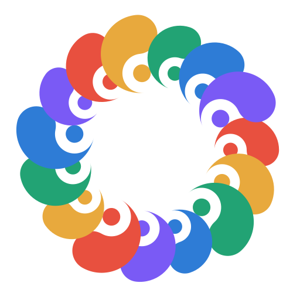
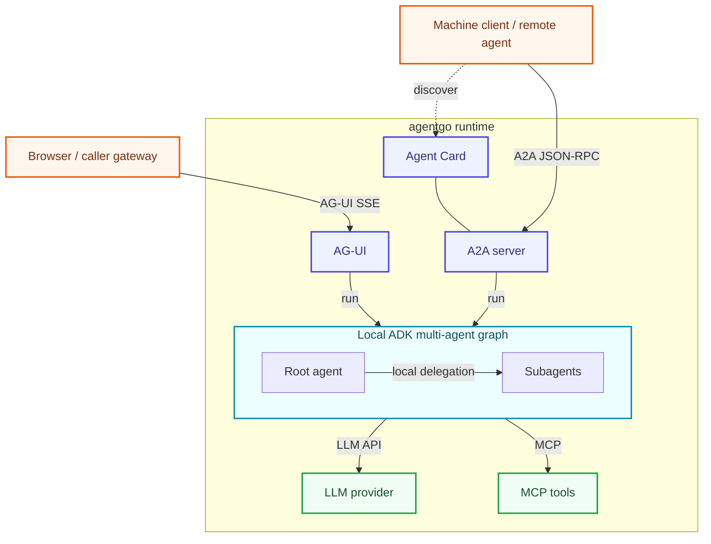

<h1 align="center">
  
  agentgo
</h1>

<p align="center">
  <strong>Turn an AgentDeployment artifact into a self-hosted, protocol-native agent service — no agent infrastructure to build.</strong>
</p>

<p align="center">
  <a href="https://github.com/ml8s/agentgo/actions/workflows/ci.yml"></a>
  <a href="https://github.com/ml8s/agentgo/releases"></a>
  <a href="https://github.com/ml8s/agentgo/blob/main/go.mod"></a>
  <a href="./LICENSE"></a>
  <a href="https://pkg.go.dev/github.com/ml8s/agentgo"></a>
</p>

<p align="center">
  
  
  
  
</p>

<p align="center">
  <a href="./README.md"></a>
  <a href="./docs/i18n/README.zh-CN.md"></a>
  <a href="./docs/i18n/README.ja.md"></a>
  <a href="./docs/i18n/README.es.md"></a>
  <a href="./docs/i18n/README.pt-BR.md"></a>
  <a href="./docs/i18n/README.de.md"></a>
</p>

## Overview

Agentgo is a generic deployment runtime for **local multi-agent graphs**. An
`AgentDeployment` artifact declares the root agent, delegated sub-agents, model
settings, and allowlisted MCP tools. The runtime executes root-to-subagent
delegation as a local ADK graph and serves the result over AG-UI and A2A + Agent
Card.

Applications integrate Agentgo as an external service, so they do not embed Go
agent code or protocol plumbing. Calling applications keep ownership of users,
business context, durable conversations, and user experience.



## Why agentgo

Building a production agent system from scratch means implementing, testing,
and maintaining all of this yourself:

| Concern | What you'd build | What agentgo gives you |
|---|---|---|
| Protocol serving | A2A JSON-RPC server, AG-UI SSE stream, Agent Card discovery | Standard protocol adapters over one shared runtime |
| Agent orchestration | Multi-agent delegation graph, tool routing, model selection | ADK Agent tree from your deployment artifact |
| Tool access | MCP client, tool allowlist, deny-by-default authorization | Server-scoped MCP allowlists; denied unless explicitly listed |
| Security | Bearer auth, OIDC verification, mutual TLS, identity mapping | Built-in, fail-closed, with explicit per-channel trust |
| Structured output | JSON Schema validation, provider-specific wire formats, text extraction | Declare a schema + JSON Pointer; agentgo handles the rest |
| Audit evidence | Immutable execution records with digests and error codes | Append-only audit with hashes, provenance, durations, and error codes; raw prompts and tool/model payloads are not stored |
| Observability | Metrics, tracing, structured logs, health probes | Prometheus, OpenTelemetry, `log/slog` with stable event names |

agentgo is not a framework you import into your code. It is a runtime you
deploy: write the artifact, point it at your LLM and MCP tools, and it serves.

### Runtime positioning

Agentgo is a generic self-hosted runtime for deploying agent services. It is
not a mini chat platform and does not try to replace user-facing AI workspaces.
The comparison below is an explicit boundary, not a feature backlog:

| Concern | Chat UI platform | agentgo |
|---|---|---|
| Primary input | An application workspace and UI | An `AgentDeployment` artifact |
| Users and groups | Application-level user management and access control | Caller-owned identity, mapped at runtime boundaries |
| Conversations | Durable application state | Caller-owned; bundled examples are in-memory demos |
| Knowledge and RAG | Often built into the workspace | Caller-owned content and MCP-provided tools |
| Tools | Platform extensions and plugins | External MCP services under explicit allowlists |
| UI | The application | Examples only; production callers own their UX |

Use agentgo when your application needs a self-hosted runtime for protocol
serving, agent orchestration, tool authorization, audit evidence, and
observability. Use your own application—or a platform like Open WebUI—when you need
a full user-facing workspace.

## Quick start and examples

The examples are self-contained agentgo consumers. They demonstrate the public
runtime surface without adding application capabilities to Agentgo.

| Example | Purpose | Port |
|---|---|---|
| [`chat`](examples/chat/README.md) | Browser chat with typed and hold-to-talk voice input | `8080` |
| [`agentgo-assistant`](examples/agentgo-assistant/README.md) | Caller-owned embedded page-aware assistant | `8081` |
| [`tax-refund-copilot`](examples/tax-refund-copilot/README.md) | Embedded generic tax-refund claim copilot using client tools | `8082` |

Running an example requires Docker Compose and GNU Make; provider credentials
stay inside agentgo, and the browser consumes only public protocols. Local
example tests additionally use the Node.js version pinned by `.nvmrc`.

```bash
git clone https://github.com/ml8s/agentgo.git
cd agentgo
```

### `chat` — typed or spoken AG-UI conversation


This is the smallest browser-to-agent path, with optional press-and-hold voice
capture in the same message box. Use it to see:

- one `AgentDeployment` served over AG-UI;
- streamed assistant text through SSE;
- tap-to-type input with Enter-to-send;
- press-and-hold browser speech recognition to create an editable transcript;
- release-to-send and slide-up-to-cancel interaction;
- optional browser speech synthesis controlled by **Speak**;
- an in-memory conversation with no localStorage or session management.

```bash
cd examples/chat
make setup
# Edit .env: set AGENTGO_LLM_API_KEY.
make test
make run
```

Open <http://localhost:8080/>.

### Local runtime development

For local runtime development with MCP fixtures, run:

```bash
cd ../..
cp .env.example .env
# Edit .env: set AGENTGO_LLM_API_KEY and MCP endpoint/token variables.
make dev
curl -sS http://127.0.0.1:8085/readyz | jq
```

## How it works

### Deployment model

Copy `dev/agent-deployment/` as a starting point. The artifact declares:

- one or more agents (instruction file, optional output schema, tool allowlist);
- logical MCP servers bound to environment variables;
- delegation edges (`sub_agents`) for multi-agent trees.

MCP allowlists use logical tool names. At runtime, ADK namespaces exposed tools
as `<server>_<name>` so two servers can safely expose the same name; audit
records map those model-facing names back to their logical server.

The unique root agent is the entrypoint. Prompts are external files; plain
text is the default. Typed output declares a JSON Schema plus a JSON Pointer
to the user-facing string.

### LLM providers

`AGENTGO_LLM_PROVIDER` selects the model implementation. The provider value
determines both the SDK adapter and the structured-output wire mode:

| Provider | Value | Structured output |
|---|---|---|
| OpenAI (and any backend that supports json_schema) | `openai` | `json_schema` (native) |
| Anthropic Claude | `anthropic` | `native` (ADK translates genai.Schema) |
| Google Gemini | `gemini` | `native` (ADK translates genai.Schema) |
| Other OpenAI-compatible (e.g. DeepSeek, Zhipu) | any other value | `json_object` (compatibility shim) |

The structured-output mode is derived automatically from the provider; no
operator override is needed.

For example, DeepSeek exposes an OpenAI-compatible endpoint. Set
`AGENTGO_LLM_PROVIDER=openai` with
`AGENTGO_LLM_BASE_URL=https://api.deepseek.com/v1` when its endpoint and model
support OpenAI JSON Schema; use `AGENTGO_LLM_PROVIDER=deepseek` for the
OpenAI-compatible `json_object` fallback. When an Agent has no output schema,
agentgo does not send a structured-output request.

Per-Agent artifact settings (`model`, `temperature`, `maxOutputTokens`) override
the environment defaults. Priority: per-agent artifact > env default > provider default.

### Protocols

| Consumer | Protocol | Endpoint | Purpose |
|---|---|---|---|
| Machine client | A2A JSON-RPC | `POST /a2a` | discovery, invocation, streaming |
| Browser / gateway | AG-UI SSE | `POST /ag-ui` | chat, tool events, sub-agent lifecycle |
| Machine discovery | A2A Agent Card | `GET /.well-known/agent-card.json` | standard capability metadata |
| Tool server | MCP Streamable HTTP | outbound | externally owned tools |

Internal root-to-subagent delegation is local ADK graph execution, not A2A.
A2A is reserved for external machine clients and remote agents across a runtime
or trust boundary.

Official specifications: [A2A](https://a2a-protocol.org/v1.0.0/specification/),
[AG-UI](https://docs.ag-ui.com/introduction), and
[MCP](https://modelcontextprotocol.io/specification/2025-06-18/basic/transports).

Operational endpoints: `/livez`, `/readyz`, `/metrics`, `/debug/pprof`
(opt-in via `AGENTGO_PPROF_ENABLED=1`).

## Security and boundaries

- **Deny-by-default tool access** — a tool call succeeds only if the tool is
  listed in the Agent's server-scoped `tools.allow`.
- **Trusted-header mode** — production requires
  `Authorization: Bearer <AGENTGO_PROTOCOL_TOKEN>`; AG-UI additionally requires
  a gateway-verified user identity header.
- **OIDC mode** — set `AGENTGO_IDENTITY_SOURCE=oidc` to verify standard ID
  tokens on both AG-UI and A2A.
- **Mutual TLS** — optional listener maps identity from client certificates.
- **Audit evidence** — append-only records with deployment digests, durations,
  and error codes; raw prompts and tool/model payloads are not stored.
- **No direct public exposure** — the runtime sits behind your gateway.

See [`SECURITY.md`](SECURITY.md) for the full security policy.

### Product boundary

agentgo is not an Agent management control plane. It does not provide Agent
CRUD APIs, deployment registries, tenant management, quota enforcement,
approval workflows, or a management console.

It is also not a chat platform or mini AI workspace. It does not own product
users, durable conversations, chat history, document libraries, RAG pipelines,
model catalogs, plugins, calendars, notes, or a user-facing workspace.

`caller` owns users, products, entitlements, quotas, and durable product
conversations. A domain content repository owns prompts, skills, workflow
policy, and tool semantics; external MCP tool services own MCP tool
implementations.

## Configuration

`.env.example` is the complete configuration surface. Key groups:

| Prefix / variable | Purpose |
|---|---|
| `AGENTGO_*` | service address, token, audit DB path, topology, deployment file, ops address |
| `AGENTGO_PROTOCOL_TOKEN` | internal service credential for production callers |
| `AGENTGO_MCP_*` | endpoint/token bindings for logical MCP servers |
| `AGENTGO_MAX_CONCURRENT_RUNS` | bounded concurrent executions (1–1024) |
| `AGENTGO_LLM_*` | provider, base URL, model, API key, temperature, max output tokens, timeout |
| `AGENTGO_IDENTITY_SOURCE` | `trusted_header` (default) or `oidc` |
| `AGENTGO_MTLS_IDENTITY_SOURCE` | mutual-TLS identity mapping |
| `AGENTGO_OIDC_*` | OIDC issuer, audience, and verified claim mapping |
| `OTEL_*` | standard OpenTelemetry tracing settings |

## Operations

Use `make dev` for Compose; `make dev-down` removes the workload. The ops
surface (`/livez`, `/readyz`, `/metrics`) listens on `AGENTGO_OPS_ADDR`
(default `:8085`). Release images probe `/readyz` via the built-in
`healthcheck` subcommand.

## Observability

Prometheus metrics cover protocol latency, active streams, model calls, tool
calls, delegation activity, and dependency readiness. Logs use `log/slog`
with stable event names. Distributed tracing uses W3C context propagation and
OTLP export (disabled unless configured).

SQLite stores append-only audit events. On startup the runtime closes
interrupted lifecycles with synthetic `runtime_interrupted` failures, never
editing history.

## Documentation

| Document | Purpose |
|---|---|
| [`docs/ARCHITECTURE.md`](docs/ARCHITECTURE.md) | runtime architecture and protocol mapping |
| [`docs/DOMAIN.md`](docs/DOMAIN.md) | stable runtime domain invariants |
| [`docs/STANDARDS.md`](docs/STANDARDS.md) | protocol and infrastructure review standards |
| [`examples/chat`](examples/chat/README.md) | minimal chat with typed and hold-to-talk voice input |
| [`examples/agentgo-assistant`](examples/agentgo-assistant/README.md) | minimal click-to-explain assistant example |
| [`examples/tax-refund-copilot`](examples/tax-refund-copilot/README.md) | embedded generic tax-refund claim copilot |
| [`dev/agent-deployment/deployment.json`](dev/agent-deployment/deployment.json) | runtime validation fixture |
| [`SECURITY.md`](SECURITY.md) | security policy and required controls |

## Development

Install Node.js from `.nvmrc`; Go resolves its toolchain from `go.mod`. Run
`npm ci` once so Markdown linting uses the locked local development dependency.
Run `make setup-hooks` once so every push runs the local gate. Then use `make
check`, `make test`, `make gate`, and `make build`.

Use `make test-local` for local integration and smoke testing. It builds the
local runtime image, starts the runtime, and verifies that it becomes live. CI
runs static checks only; keep image integration workloads local. Run
`make gate` before pushing to cover both CI and the scheduled security scan.

`make gate` is the pre-push gate. It runs documentation linting, Go static
checks, race tests with the coverage floor, the Go vulnerability scan, and the
local image smoke.

### Validate a deployment artifact

```bash
go run ./cmd/agentgo validate -deployment ./path/to/deployment.json
```

## Contributing

Follow [`CONTRIBUTING.md`](CONTRIBUTING.md) and run `make check`/`make gate`
before submitting a change.

## License

Released under the [MIT License](LICENSE).
