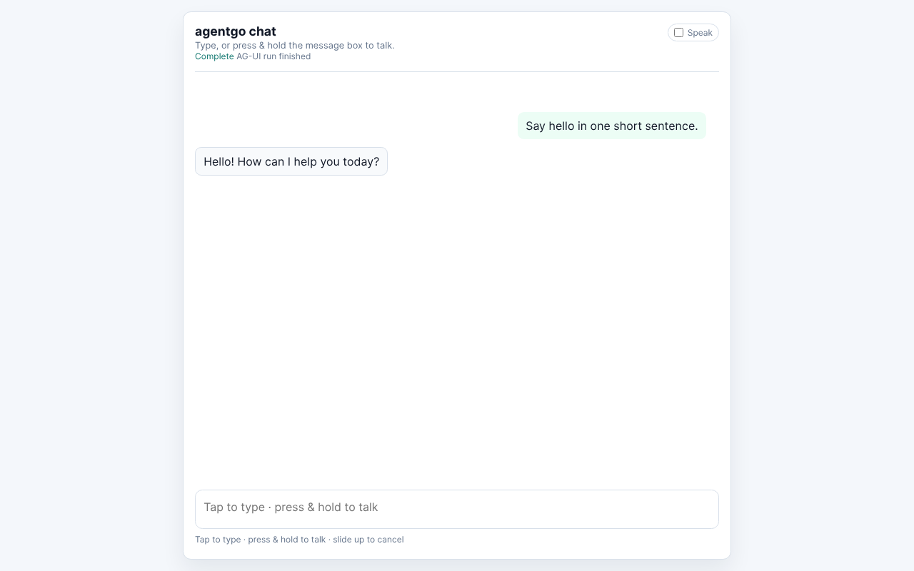
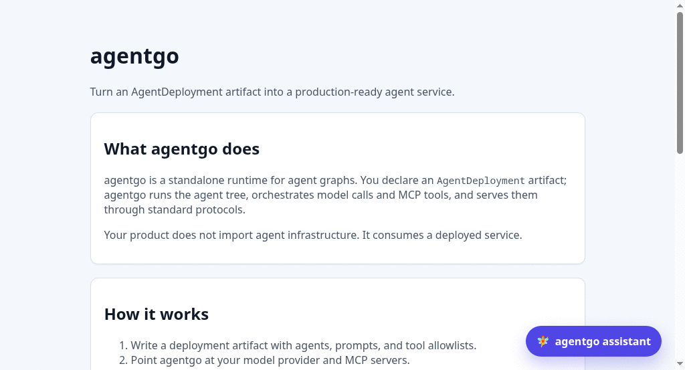

# Examples

These examples are agentgo consumers. They are not part of the runtime and do
not add product capabilities to it.

Each example is intentionally self-contained so that its deployment artifact,
UI, configuration, and instructions can be understood without reading hidden
shared code.

## Shared domain vocabulary

| Term | Meaning |
|---|---|
| `RuntimeCorrelation` | Ephemeral `threadId` and `userId` used to correlate one browser demo's AG-UI stream. Reload intentionally creates new values. |
| `ConversationMessage` | One user or assistant turn. `content` is the visible text and the AG-UI message content. |
| `AgentRun` | One AG-UI request/response lifecycle. A run is active until it finishes, fails, or is stopped. |
| `AgentRunPhase` | `idle`, `connecting`, `running`, `streaming`, `complete`, `stopped`, or `error`; set from AG-UI event callbacks or the local abort path. |
| `SelectedPageElement` | The visible page content selected for explanation, limited to 600 characters. |
| `ResponseLanguage` | Explicit `navigator.language`, shown as **Browser language** and included in the selection prompt. |

Runnable examples own their local Makefile. Per-example lifecycle targets are
authoritative; the root Makefile may expose a convenience default, but it does
not turn examples into shared runtime features.

Use the local Makefile from inside an example directory. Keep example lifecycle
targets consistent across examples: `setup`, `test` where examples have local
logic, `run`, `start`, `logs`, `stop`, and `clean`.

| Example | Purpose |
|---|---|
| [`chat`](./chat) | Minimal browser chat showing AG-UI streaming, hold-to-talk voice input, and streamed replies |
| [`agentgo-assistant`](./agentgo-assistant) | Minimal click-to-explain assistant showing small selected-element context |
| [`tax-refund-copilot`](./tax-refund-copilot) | Embedded assistant that fills a generic tax refund claim through AG-UI client tools |

## chat

**What it is:** the smallest browser conversation path, with optional voice
input.



**What to look at:** streaming text, the run status, a single message box that
supports tap-to-type and press-and-hold-to-talk, visible transcript feedback,
and optional spoken replies.
**Port:** `8080`.

```bash
cd examples/chat
make setup
# Edit .env: set AGENTGO_LLM_API_KEY.
make test
make run
```

AgentGo receives only the final transcript, not the microphone stream. Browser
speech implementations may send audio to the browser vendor's speech service.

## agentgo-assistant

**What it is:** an embedded page-aware assistant demo.
**What to look at:** selecting visible page content, a small
selected page content, explicit browser response language, and streamed
explanations. Page links and buttons are not activated by an explain click.
**Port:** `8081`.

```bash
cd examples/agentgo-assistant
make setup
# Edit .env: set AGENTGO_LLM_API_KEY.
make run
```



## tax-refund-copilot

**What it is:** an embedded tax-draft form copilot with no tax backend.
**What to look at:** a declared AG-UI client tool (`tax_refund_form_patch`),
incremental structured patches, a realistic tax refund claim form, confidence/source
metadata, and protected user-edited fields.
**Port:** `8082`.

```bash
cd examples/tax-refund-copilot
make setup
# Edit .env: set AGENTGO_LLM_API_KEY.
make test
make run
```

It prepares a frontend-only refund claim draft and does not provide tax advice,
calculate final eligibility, submit to a tax authority, or persist to a tax
backend.

## Common rules

All examples are self-contained agentgo consumers. They use consistent local
lifecycle targets and send public protocol requests to agentgo. Examples with
local logic also expose `make test`. They do not add product capabilities, user
management, or session storage to the runtime.
