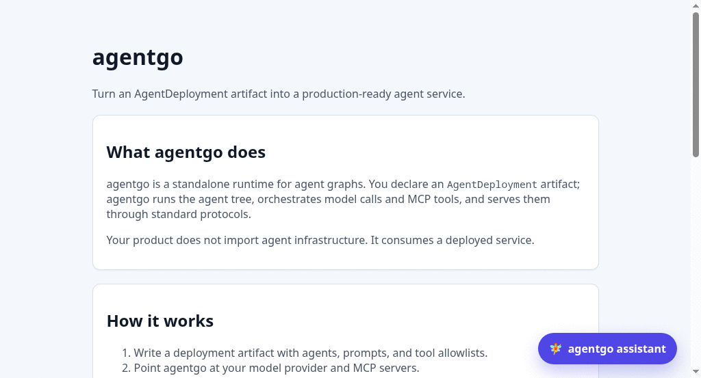

# agentgo assistant example

Run a small introduction page with an embedded “agentgo assistant”. The assistant
opens as a floating dialog. With **Explain mode** enabled, clicking selectable
page content sends that content to one agent and streams an explanation back into
the dialog.

This is an agentgo consumer, not a runtime feature. It adds no framework and no
frontend build step; the AG-UI browser client is vendored locally.

```text
click page element ──> build selection prompt ──> POST /ag-ui ──> agentgo ──> model
```



## Requirements

- Docker Compose
- GNU Make
- An API key from an OpenAI-compatible provider
- Local TCP port `8081` available

## Quick start

```bash
cd examples/agentgo-assistant
make setup
# Edit .env and set AGENTGO_LLM_API_KEY
make run
```

Open <http://localhost:8081/>.

1. Select **agentgo assistant** in the lower-right corner; select it again to close the dialog.
2. Keep **Explain** enabled.
3. Click headings, paragraphs, list items, links, or code on the page.
4. Ask follow-up questions in the dialog.

## Files

| Path | Purpose |
|---|---|
| [`agent/deployment.json`](./agent/deployment.json) | One assistant agent with an empty tool allowlist |
| [`agent/instruction.md`](./agent/instruction.md) | Assistant behavior and safety boundaries |
| [`assistant-ui/index.html`](./assistant-ui/index.html) | agentgo introduction page and floating dialog |
| [`assistant-ui/app.js`](./assistant-ui/app.js) | Element extraction, explain mode, and AG-UI streaming |
| [`assistant-ui/vendor/ag-ui-client.js`](./assistant-ui/vendor/ag-ui-client.js) | Locally vendored AG-UI client |

## Design

Explain mode uses a capture-phase click listener. Selectable page content is not
activated; instead, the UI highlights it, opens the dialog, shows the selected
content, and sends a small selection prompt with only the visible selected text
(up to 600 characters) and the browser response language.

The UI does not send page title, section headings, ARIA metadata, hidden author
labels, complete HTML, element attributes, or input values.

The listener excludes the assistant launcher and dialog. It never reads input or
textarea values. Assistant requests use the same-origin `/ag-ui` proxy, so the
browser never sees the provider API key.

## Make targets

Run from this directory:

| Target | Behavior |
|---|---|
| `make setup` | Creates `.env` without overwriting an existing file |
| `make run` | Builds and runs both services in the foreground |
| `make start` | Builds and runs both services in the background |
| `make logs` | Follows logs from both services |
| `make stop` | Stops and removes containers |
| `make clean` | Stops, removes containers, and deletes local data |

`AGENTGO_PROTOCOL_TOKEN` is empty in this local example. Do not expose agentgo
directly to an untrusted network with authentication disabled.
