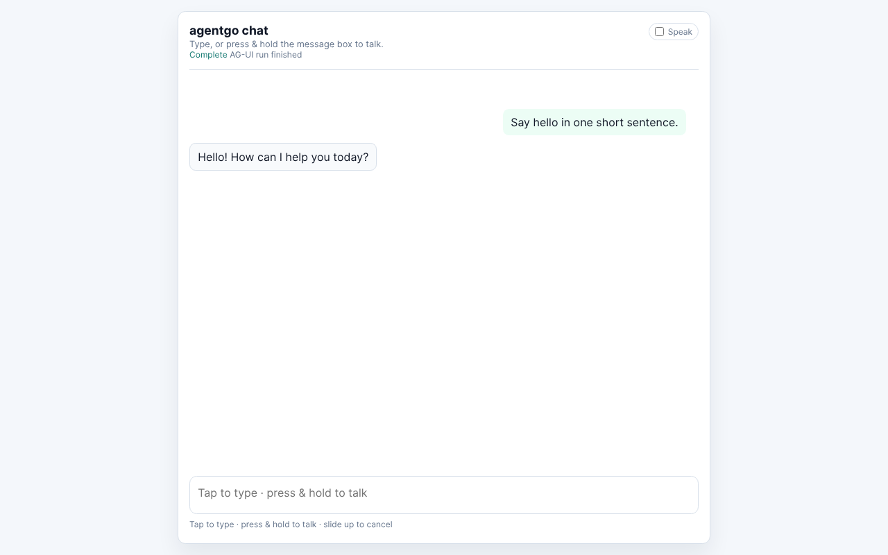

# agentgo chat example

Run one browser chat that supports typing and optional hold-to-talk voice
capture. Text and speech both become ordinary AG-UI messages; AgentGo streams
the reply back to the same conversation.

This example is intentionally self-contained. It has no framework, no build
pipeline, no database, and no product code inside the runtime.



```text
typed text / speech transcript
        ↓
POST /ag-ui
        ↓
AgentGo → LLM
        ↓
SSE streaming reply
```

## What it shows

- minimal AG-UI browser chat;
- streamed assistant text;
- text input with Enter-to-send;
- optional hold-to-talk browser speech capture;
- release to send and slide-up to cancel;
- editable/visible transcript before a voice message is submitted;
- typed fallback when Web Speech recognition is unavailable;
- optional browser speech synthesis for replies.

AgentGo receives only the final transcript, not the microphone stream. Browser
speech implementations may send audio to the browser vendor's speech service.

## Requirements

- Docker Compose
- GNU Make
- An API key from an OpenAI-compatible provider
- Local TCP port `8080`
- For press-and-hold capture: a browser with Web Speech recognition; `localhost` or HTTPS is required

Running the example does not require local Go or Node.js. `make test` uses the
Node version pinned by [`.nvmrc`](../../.nvmrc).

## Quick start

```bash
cd examples/chat
make setup
# Edit .env and set AGENTGO_LLM_API_KEY.
make test
make run
```

Open <http://localhost:8080/>.

## Composer interaction

The message box is a single control for both input modes.

- Tap or click it to type normally.
- Press and hold it for about 280 ms to start browser speech recognition.
- Release inside the input area to send the transcript.
- Drag upward/outside to arm cancel, then release to cancel.
- While recording, the transcript is visible in the message box and errors are
  shown below it.
- Press **Enter** to send typed text; use **Shift+Enter** for a newline.
- Use **Speak** in the header to control whether the final reply is read aloud
  with browser speech synthesis.

**Speak** only controls playback of the assistant reply. It does not affect
recognition, transcript generation, or what is sent to AgentGo.

If speech recognition is unavailable or fails, typed input continues to work.
## Local checks

```bash
make test
```

Tests cover:

- final and interim transcript accumulation;
- release-to-send behavior, including late final recognition results;
- cancel behavior, including late recognition results after release;
- microphone permission and getUserMedia constraints;
- DOM contract between `index.html` and `app.js`;
- same-origin `/ag-ui` usage.

## Security boundary

The browser talks only to the same-origin `/ag-ui` proxy. Provider credentials
stay inside AgentGo. The demo owns no durable session and no message storage;
reloading creates a new browser-local conversation.

`AGENTGO_PROTOCOL_TOKEN` is intentionally empty for local development. Do not
expose the service directly to an untrusted network.

## Cleanup

```bash
make stop
# Or remove the local AgentGo session volume too:
make clean
```
