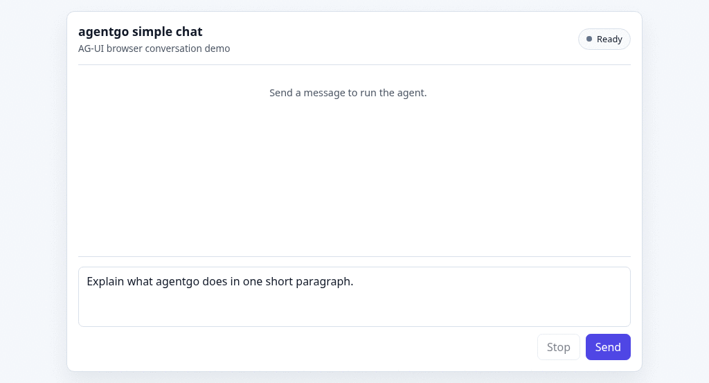

# Simple chat example

Run a minimal browser chat backed by one agentgo agent. The example has no MCP
tools and no product code inside the runtime.

This example is an agentgo consumer. It demonstrates the shortest path from a
deployment artifact and provider credentials to a browser conversation.

```text
browser ──HTTP──> chat-ui ──POST /ag-ui──> agentgo ──LLM──> provider
```



`chat-ui` is a separate example consumer. It serves one static page and proxies
the standard AG-UI endpoint to agentgo.

## Requirements

- Docker Compose
- GNU Make
- An API key from an OpenAI-compatible provider
- Local TCP port `8080` available

The defaults use DeepSeek through its OpenAI-compatible endpoint.

## Files

| Path | Purpose |
|---|---|
| [`Makefile`](./Makefile) | Local lifecycle commands for this example |
| [`docker-compose.yml`](./docker-compose.yml) | Starts agentgo and the chat UI |
| [`.env.example`](./.env.example) | Template for local, non-secret defaults |
| [`agent/deployment.json`](./agent/deployment.json) | Declares one chat agent and no tools |
| [`agent/instruction.md`](./agent/instruction.md) | The agent's identity and prompt |
| [`chat-ui/index.html`](./chat-ui/index.html) | Minimal browser UI using the AG-UI client |
| [`chat-ui/app.js`](./chat-ui/app.js) | Browser-side AG-UI event handling |
| [`chat-ui/vendor/ag-ui-client.js`](./chat-ui/vendor/ag-ui-client.js) | Locally vendored AG-UI client and dependencies |
| [`chat-ui/package.json`](./chat-ui/package.json) | Pins and rebuilds the vendored AG-UI bundle |
| [`chat-ui/Caddyfile`](./chat-ui/Caddyfile) | Serves the UI and proxies `/ag-ui` |

## Quick start

```bash
cd examples/simple-chat
make setup
```

Edit `.env` and set `AGENTGO_LLM_API_KEY`. Then run:

```bash
make run
```

Open:

<http://localhost:8080/>

agentgo is not published to the host. The browser talks only to `chat-ui`, and
`chat-ui` forwards `/ag-ui` to the runtime.

The checked-in AG-UI bundle is built from `chat-ui/package.json`. To regenerate
it after changing or upgrading the dependency:

```bash
cd examples/simple-chat/chat-ui
npm ci
npm run build:vendor
```

## Make targets

Run these commands from `examples/simple-chat/`.

| Target | Behavior |
|---|---|
| `make setup` | Creates `.env` from `.env.example` without overwriting an existing file |
| `make run` | Rebuilds images and runs both services in the foreground |
| `make start` | Rebuilds images and runs both services in the background |
| `make logs` | Follows logs from both services |
| `make stop` | Stops and removes containers, but keeps the local data volume |
| `make clean` | Stops, removes containers, and deletes the local data volume |
| `make help` | Shows the available targets |

`make clean` deletes the runtime data volume. It is intended for a fresh example
run, not for a workload containing information you need to keep.

To override the Compose command, use:

```bash
make run COMPOSE='podman compose'
```

## Configuration

`.env` is read by Docker Compose and passed to agentgo. The required provider
settings are:

| Variable | Meaning |
|---|---|
| `AGENTGO_LLM_PROVIDER` | Model adapter: `openai`, `anthropic`, `gemini`, or an OpenAI-compatible label |
| `AGENTGO_LLM_BASE_URL` | Absolute HTTP(S) endpoint for the provider API |
| `AGENTGO_LLM_MODEL` | Model name understood by the selected provider |
| `AGENTGO_LLM_API_KEY` | Provider credential kept only in agentgo's environment |

The Compose file sets `AGENTGO_ENV=development`, `AGENTGO_PROTOCOL_TOKEN=`, and
`AGENTGO_DEPLOYMENT_FILE=/conf/deployment.json`. This makes the example usable
locally without a bearer token or gateway.

### Default DeepSeek configuration

```env
AGENTGO_LLM_PROVIDER=openai
AGENTGO_LLM_BASE_URL=https://api.deepseek.com/v1
AGENTGO_LLM_MODEL=deepseek-chat
AGENTGO_LLM_API_KEY=sk-your-deepseek-key
```

`openai` means "use the OpenAI-compatible ADK adapter"; it does not require the
endpoint to be operated by OpenAI.

### Changing provider

Set the provider adapter, endpoint, model, and key together. For example:

```env
AGENTGO_LLM_PROVIDER=openai
AGENTGO_LLM_BASE_URL=https://api.openai.com/v1
AGENTGO_LLM_MODEL=your-openai-model
AGENTGO_LLM_API_KEY=your-key
```

After changing `.env`, restart the runtime:

```bash
docker compose up -d --force-recreate agentgo
```

Provider selection is startup configuration. The example does not reload it
dynamically.

## Customize the agent

`agent/deployment.json` declares one chat agent and an empty tool allowlist.
`agent/instruction.md` is its prompt.

To change the prompt:

1. edit `agent/instruction.md`;
2. run `docker compose restart agentgo`.

The deployment artifact is loaded at startup. This keeps startup explicit and
auditable; the example intentionally does not implement hot reload.

To change the agent name, description, artifact version, or future tool policy,
edit `agent/deployment.json` and restart agentgo.

## Demo behavior

The UI is a small conversation demo. Messages stay in page memory only, and the
status pill exposes the current AG-UI task phase:

| Status | Meaning |
|---|---|
| Ready | No run is active |
| Connecting | The browser is opening `/ag-ui` |
| Agent running | `RunStarted` arrived |
| Streaming | Assistant text is streaming |
| Complete | `RunFinished` arrived |
| Stopped | The browser aborted the run |
| Failed | The runtime or provider returned an error |

The browser creates ephemeral user and thread IDs with `crypto.randomUUID()`.
They exist only for AG-UI correlation. Reloading the page starts an empty demo
conversation; this example intentionally has no localStorage, session restore,
conversation list, or server-side user model.

The browser never receives the provider API key. It only sends AG-UI requests
to same-origin `/ag-ui`; Caddy forwards that endpoint to internal agentgo.

## Runtime layout

```text
host port 8080 ──> chat-ui
                    ├─ GET /        static example UI
                    └─ POST /ag-ui ─> agentgo:8083

agentgo:8083       internal protocol listener, not published
agentgo:8085       internal ops listener, not published
```

Do not add a host mapping for agentgo unless you understand the security
implications. The example is designed so the browser reaches the runtime only
through the UI's same-origin AG-UI proxy.

## Check status

Check containers:

```bash
docker compose ps
```

Run the runtime's built-in health check:

```bash
docker compose exec agentgo /agentgo healthcheck
```

Check that the UI is reachable:

```bash
curl -I http://localhost:8080/
```

If you modify the deployment artifact and have Go installed, validate it from
the repository root:

```bash
go run ./cmd/agentgo validate \
  -deployment examples/simple-chat/agent/deployment.json
```

## Troubleshooting

### `make run` says `.env not found`

Run:

```bash
make setup
```

Then edit `.env`, especially `AGENTGO_LLM_API_KEY`.

### Compose says a provider value is required

Set all three values in `.env`:

```env
AGENTGO_LLM_PROVIDER=openai
AGENTGO_LLM_BASE_URL=https://api.deepseek.com/v1
AGENTGO_LLM_MODEL=deepseek-chat
```

### Chat fails after sending a message

Follow logs while retrying in the browser:

```bash
make logs
```

Common causes are an invalid provider key, an unreachable provider endpoint, an
unsupported model name. The AG-UI browser dependency is vendored locally, so a
CDN is not required at runtime.

### Port `8080` is already used

Edit `docker-compose.yml` and change the host side of the mapping:

```yaml
ports:
  - "8081:8080"
```

The browser URL then becomes `http://localhost:8081/`. If you consume Agent
Card discovery externally, also update `AGENTGO_PUBLIC_URL` so it matches the
externally reachable address.

### You edited the chat UI files

The UI files are copied into the Caddy image. Rebuild:

```bash
make start
```

`make start` uses Compose build, so the static UI image is refreshed. If the
service is already running and you prefer not to use the Makefile:

```bash
docker compose build chat-ui
docker compose up -d chat-ui
```

### You want a completely fresh demo

```bash
make clean
make setup
```

Then edit `.env` and run `make run`.

## Security boundary

This is a local development example. It runs agentgo in development mode with
trusted-header identity and no bearer token so a browser page can use AG-UI
directly.

Do not expose this Compose workload directly to the public internet. A
production deployment needs your gateway authentication, production runtime
configuration, and a UI owned by your application.

This example intentionally does not turn agentgo into a product chat service.
It stays a local, self-contained demonstration of the runtime's standard AG-UI
contract.
